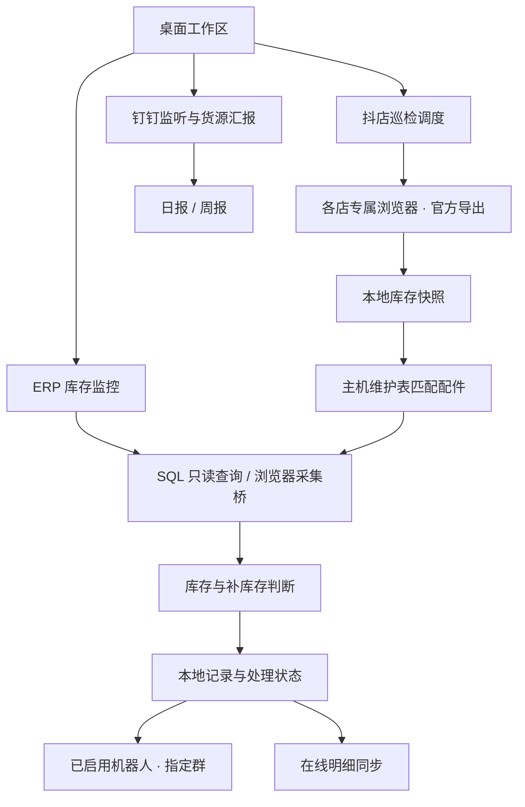

# 结构与数据流

## 模块结构

## 仓库文件导航

| 文件 / 目录 | 职责 |
| --- | --- |
| `inventory_app.py`、`inventory_workspace.py`、`inventory_panel.py` | 程序入口与桌面工作区 |
| `inventory_monitor.py`、`inventory_rules.py`、`sql_inventory_source.py` | 库存存储、规则与 SQL 来源 |
| `douyin_inventory.py`、`douyin_inventory_runtime.py` | 店铺数据与巡检队列 |
| `douyin_browser.py`、`douyin_managed_export.py` | 专属浏览器与官方导出 |
| `douyin_maintenance.py`、`douyin_erp.py` | 配件解析与 ERP 核对 |
| `douyin_restock.py`、`douyin_online.py` | 补库存建议与在线明细 |
| `notification_*.py`、`douyin_notification.py` | 通知配置与投递 |
| `inventory_cache.py`、`douyin_export_cleanup.py` | 本地缓存与导出文件清理 |
| `tests/`、`packaging/` | 回归测试与打包配置 |

仓库当前保持平铺源码结构，避免仅为目录美观破坏已有导入及打包路径。说明文档集中到 `docs/`，首页提供统一入口。

本机开发工程已经采用 `app/src`、`app/ui`、`app/runtime`、`tools`、`tests`、`docs` 布局；该布局尚未整体迁入此发布仓库，两者不能混用构建命令。

## 数据边界

官方导出是某个时间点的库存快照，不能据此断言商品前台在售。配件判断依赖维护表匹配及 ERP 查询，未知库存不当作零库存。群通知、在线明细、本地展示分别有自己的完成状态，排队成功不等于发送或同步成功。

升级保留 `.local_inventory_ui_test` 与用户目录中的 `DingTalkSourceMonitor` 数据。运行数据库、登录资料、密钥、机器人地址及业务导出不纳入仓库。
