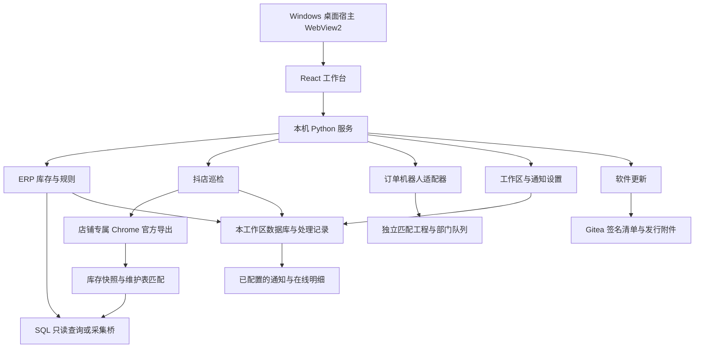
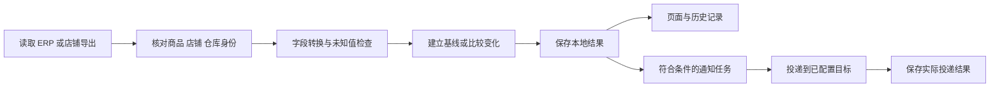

# 结构与数据流

## 模块结构

桌面宿主只负责展示。Python 服务复用库存实例和业务调度，绑定本机地址；网页业务接口与机器人只读接口权限分开。订单匹配工程独立运行，兼容层负责配置与调用，不等于完整安装该工程。

## 源码导航

以下 Python 文件均位于 `app/src/`。

| 模块 | 职责 |
| --- | --- |
| `inventory_app.py`、`InventoryConsoleHost.cs` | 程序生命周期、托盘与桌面宿主 |
| `inventory_console.py`、`app/web/src/` | 本机接口、页面与软件更新入口 |
| `inventory_business*.py` | 同窗业务操作、状态和异步任务 |
| `inventory_monitor.py`、`inventory_rules.py`、`sql_inventory_source.py` | 库存存储、判断与 SQL 适配 |
| `douyin_inventory_runtime.py`、`douyin_managed_export.py` | 店铺巡检、浏览器导出与调度 |
| `douyin_maintenance.py`、`douyin_erp.py`、`douyin_restock.py` | 维护表解析、ERP 核对与补库存建议 |
| `notification_*.py`、`douyin_notification.py` | 通知配置、投递与状态 |
| `order_bot_adapter.py`、`order_bot_config.py` | 外部订单服务连接、独立配置及兼容部署 |
| `inventory_workspace_config.py`、`inventory_cache_schedule.py` | 工作区定位及缓存清理计划 |
| `inventory_updater.py`、`app/ui/apply-update.ps1` | 清单验签、下载校验、替换与启动回执 |
| `tests/`、`tools/` | 回归测试、环境部署、构建及验收 |

## 库存与通知数据流

SQL 实际可销为同库房 `分库可销数 − 分库待审`；缺失必要字段或仓库记录不能当作零库存。官方导出是某个时点的后台快照，不能据此断言前台可购买。群通知、在线明细和本地展示分别记录完成状态，排队成功不等于已投递。

## 数据位置与更新边界

| 数据 | 位置或规则 |
| --- | --- |
| 显式工作区 | 启动参数 `--data-dir` 指定的目录优先 |
| 旧安装工作区 | 程序旁 `.local_inventory_ui_test/inventory.sqlite3` 存在时继续原位使用 |
| 新安装工作区 | `%LOCALAPPDATA%/BackendInventoryMonitor/workspaces/<安装目录摘要>` |
| 订单队列与登录 | 按订单机器人设置绑定的独立目录，不由复制 EXE 自动迁移 |
| 更新缓存与回执 | 当前工作区的 `updates/` |
| 更新恢复文件 | 原 EXE 旁的 `.rollback-*`；失败版本按助手实际处理结果保留 |

改变部门显示名称不会移动数据。把程序复制到另一个目录可能生成新的默认工作区；迁移应明确原数据目录。当前同机并行仍受固定业务服务端口约束，独立工作区不代表能同时运行多个实例。

更新器只替换当前 EXE，保留工作区和启动参数中的数据目录。清单验签、包大小和 SHA-256 校验通过后才进入安装；新版完成启动回执后才确认成功。详细回滚限制见 [使用说明](使用说明.md#更新与恢复)。
